# AI-Based Facial and Iris Recognition Hostel Security System


A final-year-project web application for **a single hostel**. Students enter by **face recognition with a blink (liveness) check**
using the browser's built-in camera. The system records every entry, builds daily attendance, handles guest visits, raises
emergency and security alerts, and emails parents a weekly report.

> **Software only.** There is no door hardware: "door unlocked / locked" is a status shown on screen and saved in the log.
> **Not production-grade biometric security.** The blink check is not strong anti-spoofing, and the optional eye-region matching is
> not true iris recognition. Read [docs/limitations.md](docs/limitations.md) before relying on it.

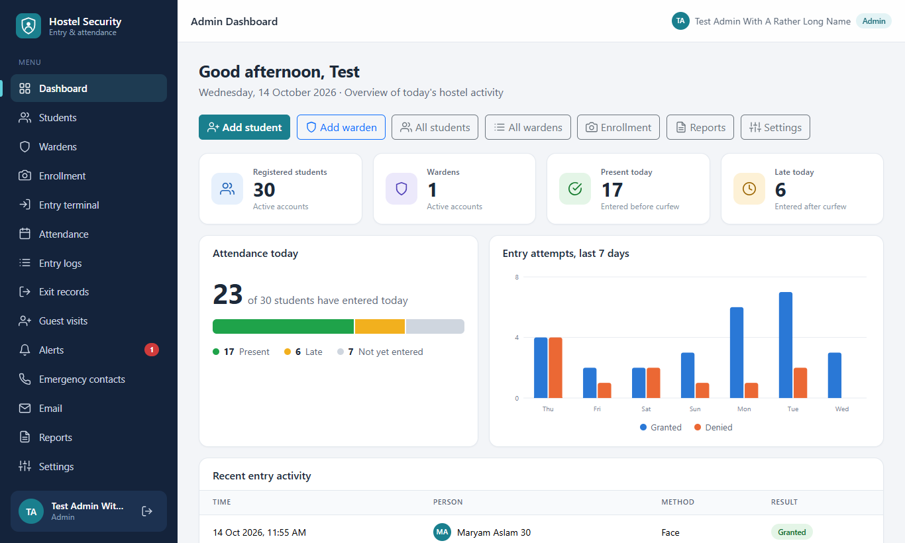

## Tags
`flask` `python` `sqlite` `face-recognition` `opencv` `dlib` `liveness-detection` `blink-detection` `attendance-system`
`hostel-management` `biometrics` `bootstrap5` `final-year-project` `computer-vision` `rbac` `csrf-protection`

## Features
- **Three roles** (admin, warden, student) with server-side role checks on every page
- **My account** page for every role: change your own email and password (asks for the current password)
- **Face enrollment** in the browser: 5 quality-checked samples, consent required, photos are never stored (only an encrypted template)
- **Entry terminal** (no login, gate computer only): face match + blink liveness check, clear result and reason
- **Automatic attendance**: Present / Late by curfew, hostel-day logic (a 00:30 arrival counts for the previous day)
- **Append-only entry log**: the database itself refuses edits and deletes
- **Guest visits**: student requests, warden approves (time window, number of entries), guest face enrolled for the visit
- **Exit records** for students and guests
- **Alerts**: student emergency button, automatic security alert after repeated failed attempts, acknowledge workflow
- **Email** (optional SMTP): alerts to wardens/emergency contacts, weekly parent attendance report, queue with retry and status
- **Reports**: daily, weekly and monthly; attendance, security and parent-email tabs; search, sort, print layout
- **Responsive UI** for phone, tablet and desktop (checked in a real browser)
- **Security**: hashed passwords, login lockout, idle session timeout, CSRF tokens, parameterized SQL, safe error pages, security headers
- **914 automated tests**, including an access-control test for every route and every role

## Tech stack
| Part | Technology |
|---|---|
| Backend | Python 3.11, Flask, Flask-Mail, APScheduler |
| Database | SQLite (created automatically) |
| Frontend | Jinja templates, Bootstrap 5, vanilla JavaScript |
| Face recognition | dlib / `face_recognition` (128-number face templates), OpenCV, NumPy |
| Template protection | Fernet encryption (`cryptography`) |
| Tests | pytest (+ real-browser checks with Playwright, outside the repo) |

## Screenshots
Demo data only (made-up names); no real students or faces.

| | |
|---|---|
| 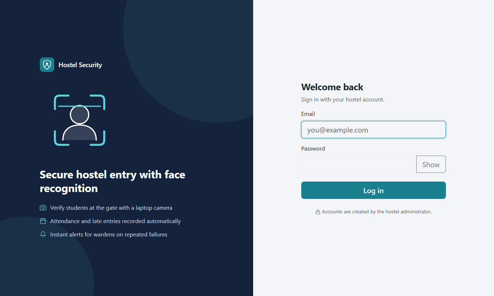 **Login** | 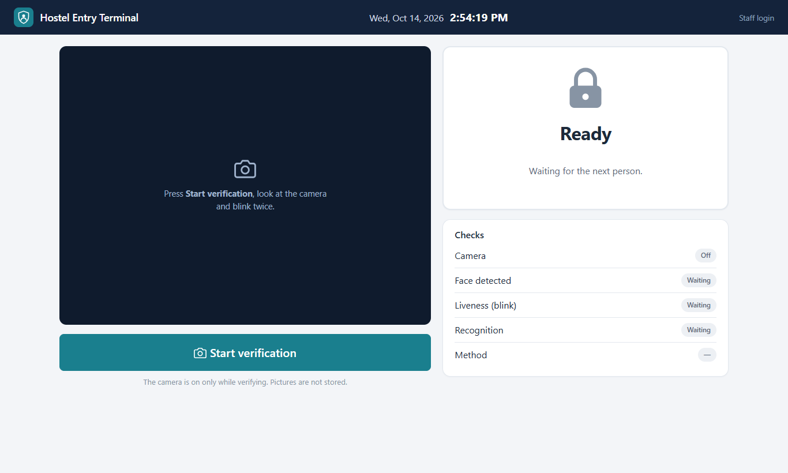 **Entry terminal** |
| 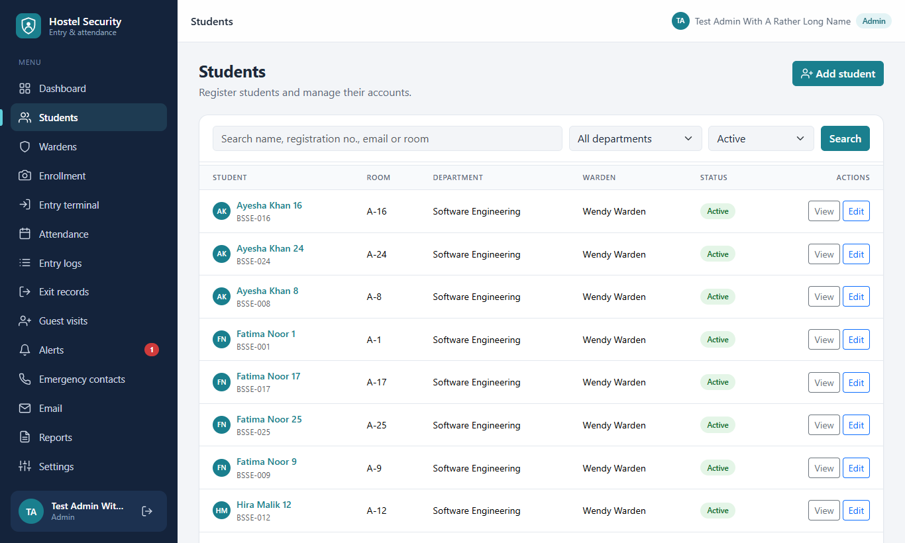 **Students** | 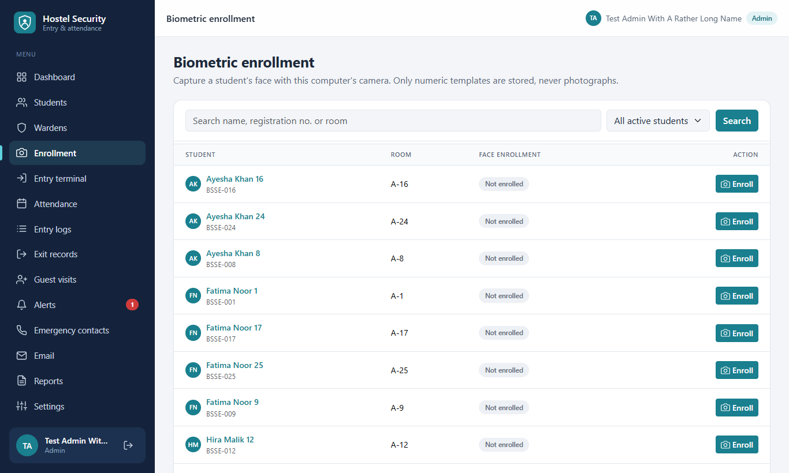 **Face enrollment** |
| 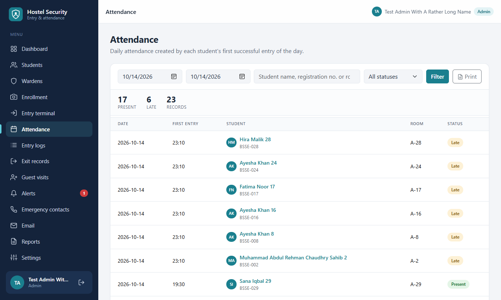 **Attendance** | 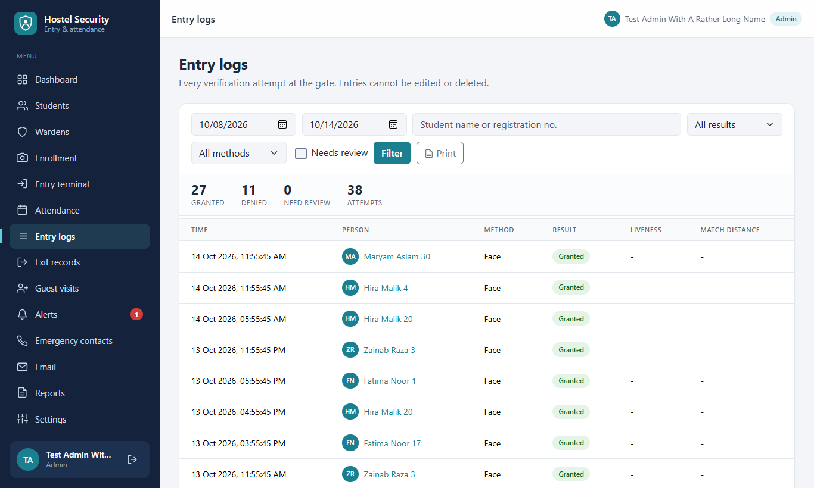 **Entry log** |
| 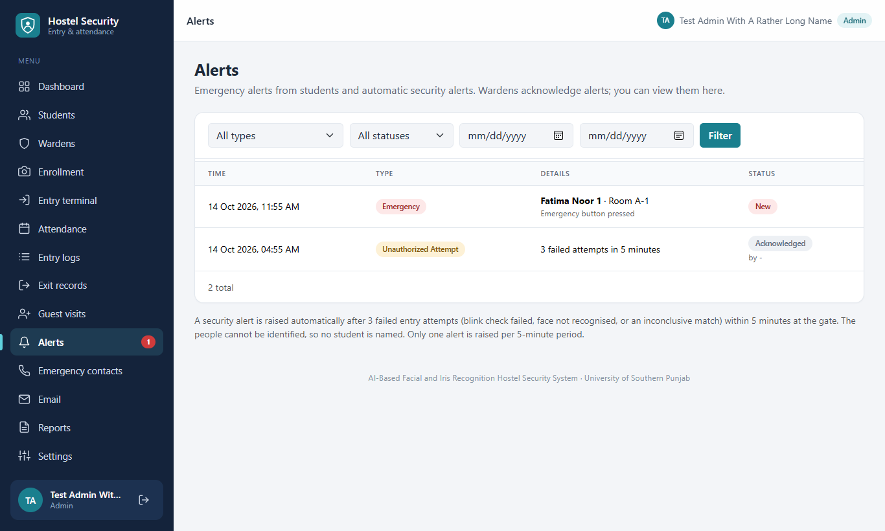 **Alerts** | 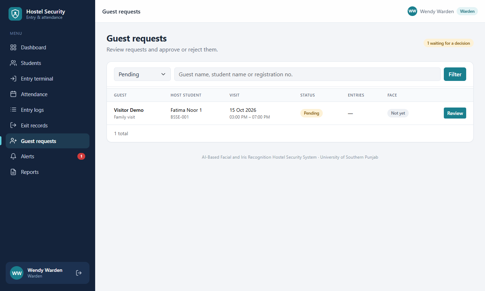 **Guest requests** |
| 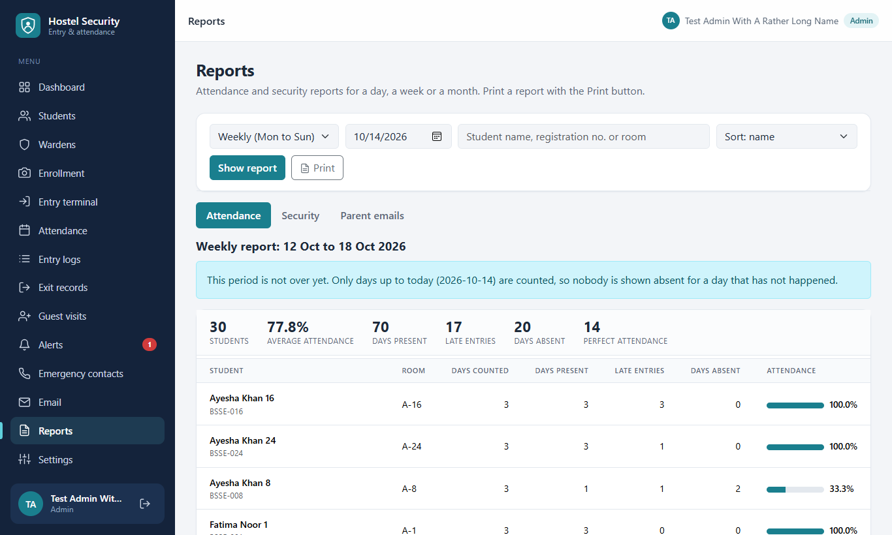 **Attendance report** | 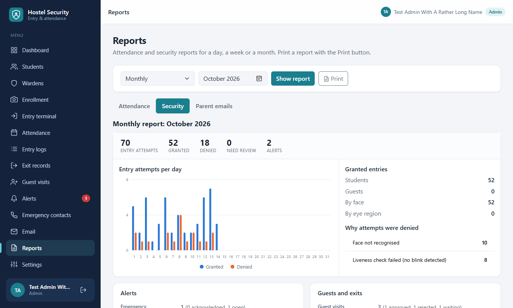 **Security report** |
| 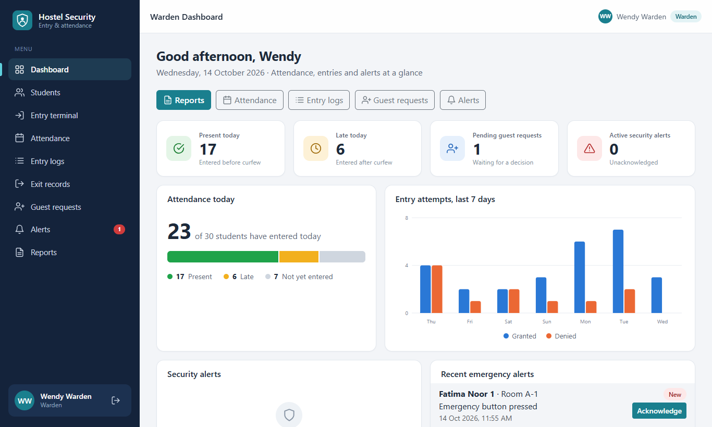 **Warden dashboard** | 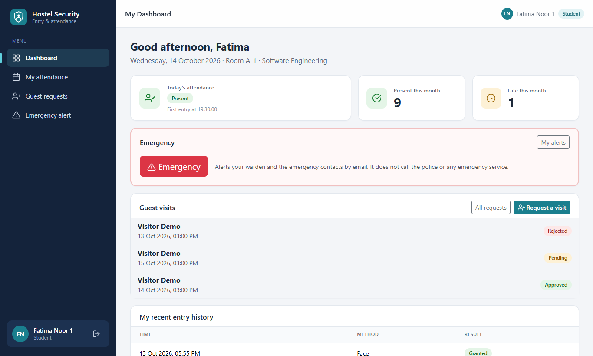 **Student dashboard** |
| 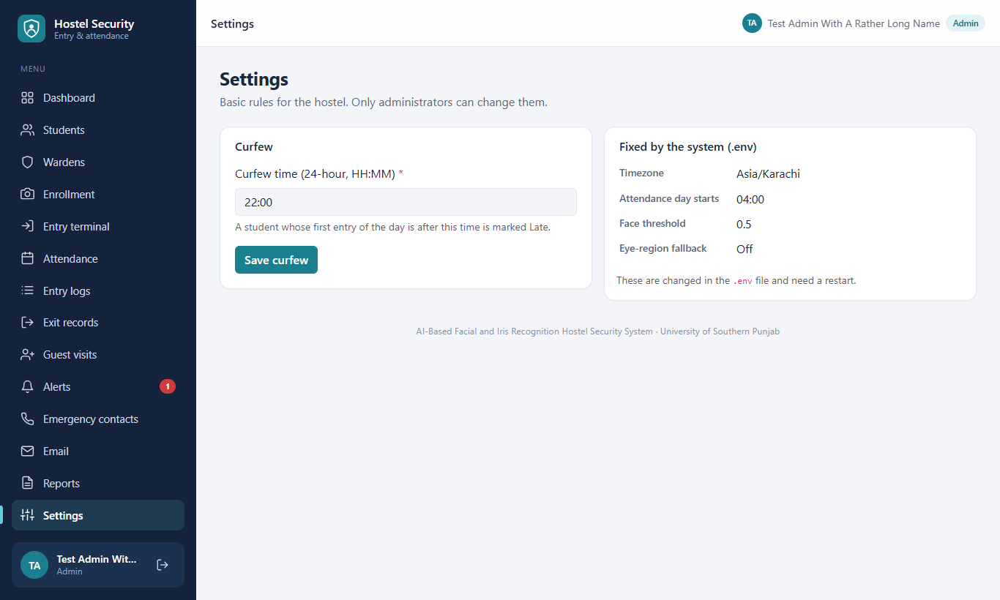 **Settings** | 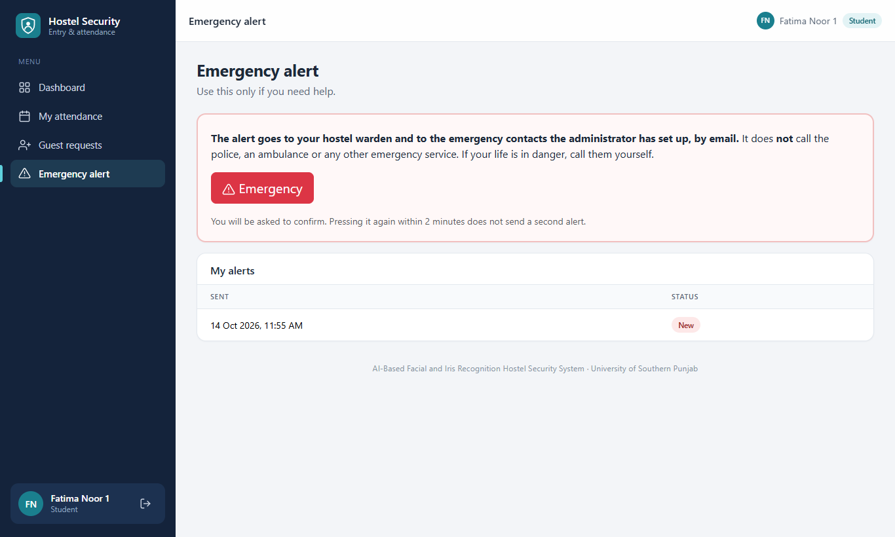 **Student emergency alerts** |

On a phone:

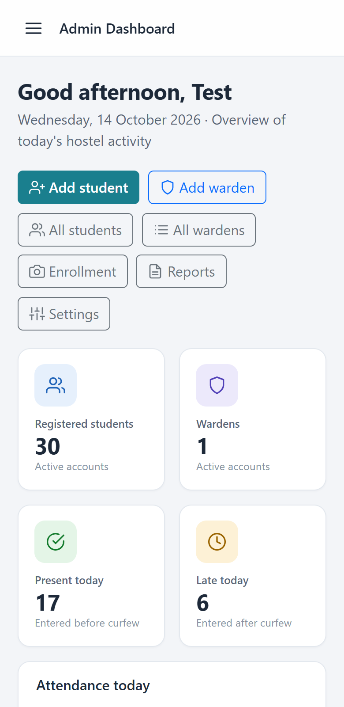 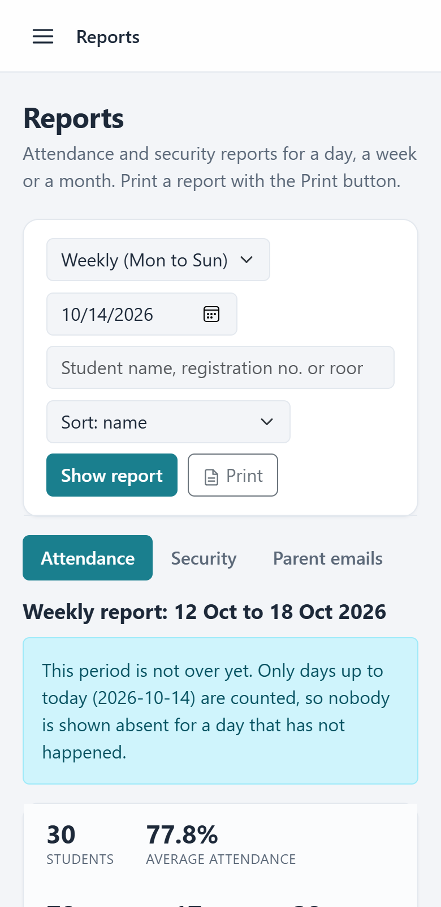

## How to run (Windows, PowerShell)

Requirements: Windows, **Python 3.11**, a browser with a camera (Edge or Chrome).

```powershell
git clone https://github.com/fatimanisar429-oss/AI_Based_facial_recognition_system.git
cd AI_Based_facial_recognition_system
python -m venv .venv
.\.venv\Scripts\Activate.ps1
pip install -r requirements.txt
pip install --no-deps face_recognition==1.3.0
Copy-Item .env.example .env
```

Open `.env` and set:

1. `SECRET_KEY` to a long random value: `python -c "import secrets; print(secrets.token_hex(32))"`
2. `BIOMETRIC_KEY` to the output of `flask --app run generate-biometric-key`. **Back this key up**: without it, enrolled faces cannot be read.

Create the first administrator and start the app:

```powershell
flask --app run create-admin          # asks for name, email, phone and password
python run.py                         # open http://127.0.0.1:5000
```

The database file (`instance/hostel.db`) is created automatically on first start. Starting again never deletes data.

### Try it quickly with demo accounts (local only)
```powershell
flask --app run create-demo-users
```
Set `DEV_QUICK_LOGIN=1` in `.env`, restart, and the login page shows one-click Admin / Warden / Student / "Register a face" buttons.
**Keep it `0` for anything other than your own computer.** It only works from `127.0.0.1`.

### Using the camera
Open `http://127.0.0.1:5000` (or `localhost`) **on the same computer** and click Allow when the browser asks. Other addresses need
HTTPS before the browser permits the camera. Details and troubleshooting: [docs/camera-setup.md](docs/camera-setup.md).

## Pages by role
| Role | What they can do |
|---|---|
| Admin | Own account (email and password), students and wardens, face enrollment, settings, emergency contacts, email status, reports, logs, attendance, alerts |
| Warden | Own account (email and password), students (view), attendance, logs, exits, guest requests (approve/reject, enroll a guest's face), alerts (acknowledge), reports |
| Student | Own account (email and password), own dashboard, own attendance, guest visit requests, emergency button |
| Entry terminal (`/terminal/`) | No login; works only from the gate computer (see `TERMINAL_ADDRESSES`) |

## Tests
```powershell
python -m pytest -q                                   # whole suite (about 15 minutes)
python -m pytest tests/test_security_review.py -q     # access control, CSRF and secrets review (about 20 seconds)
```
The tests use a temporary database; they never touch your real data.

## Project layout
```
app/                Flask application
  blueprints/       one file per area (auth, students, terminal, reports, ...)
  services/         the logic, free of Flask (recognition, attendance, alerts, email, reports)
  templates/        Jinja pages        static/   CSS, JavaScript, Bootstrap
  schema.sql        database tables    cli.py    admin / demo / email commands
docs/               guides, limitations, security review, screenshots
tests/              pytest suite
run.py              starts the app
```

## Documents
- [docs/demo-guide.md](docs/demo-guide.md): a step-by-step script for presenting the project
- [docs/manual-test-checklist.md](docs/manual-test-checklist.md): what to click and what you should see
- [docs/security-review.md](docs/security-review.md): what is protected and how it was checked
- [docs/limitations.md](docs/limitations.md): what the system does **not** do
- [docs/camera-setup.md](docs/camera-setup.md), [docs/recognition-limits.md](docs/recognition-limits.md), [docs/biometric-data-lifecycle.md](docs/biometric-data-lifecycle.md), [docs/alerts-and-email.md](docs/alerts-and-email.md)

## Never commit
`.env`, `instance/`, `*.db`: they hold password hashes, student data and encrypted face templates. They are already in `.gitignore`.
